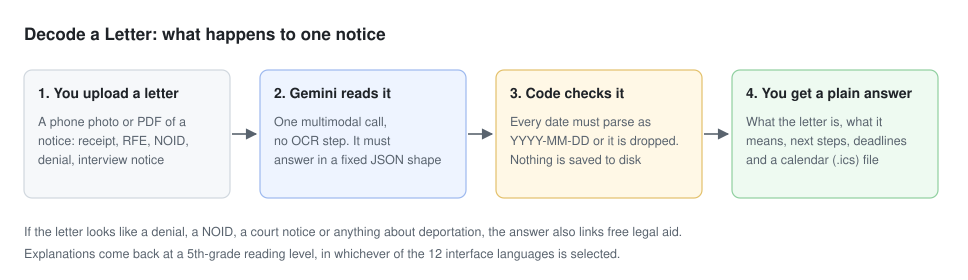
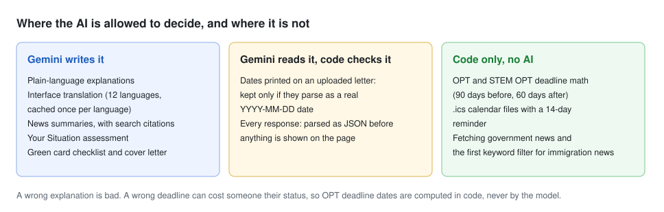
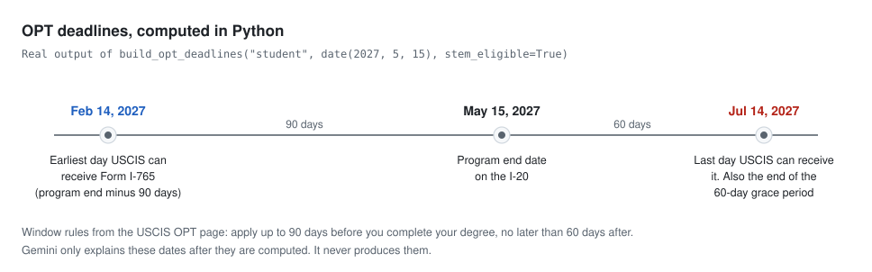
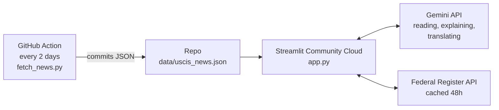
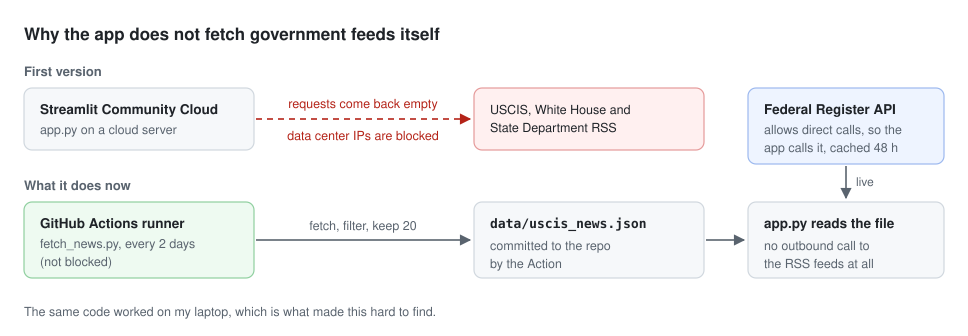

# Immigration Co-Pilot

Photograph a letter from USCIS and get a plain answer: what it is, what it means, and every deadline in it, in one of 12 languages.

<p>
  <a href="https://immigration-copilot-adazqhaecrqc8g7dujpe7h.streamlit.app/"></a>
  <a href="https://github.com/sainakakkar2006/immigration-copilot/actions/workflows/fetch_uscis_news.yml"></a>
  
  <a href="LICENSE"></a>
</p>

Immigration Co-Pilot is a free web tool for immigrant families who are trying to understand the US immigration system. I built it for people who cannot afford an attorney and need plain-language answers about what is happening in their case and what to do next, in their own language.

<p align="center">
  
</p>

> [!IMPORTANT]
> This is not a law firm and it does not give legal advice. Every page links free legal aid at [immigrationlawhelp.org](https://www.immigrationlawhelp.org). If your case involves prior violations, criminal history or deportation proceedings, talk to a licensed immigration attorney.

**Try it:** [Live app on Streamlit](https://immigration-copilot-adazqhaecrqc8g7dujpe7h.streamlit.app/) · [Project site](https://sainakakkar2006.github.io/immigration-copilot/)

## The problem

People in immigration court have no right to a free lawyer. The court is civil, so the public defender system does not apply. Most people are on their own with letters full of form numbers and hard deadlines, usually in English.

- At the end of December 2023, people had a lawyer in only **30%** of the 3,287,058 pending immigration court cases. At the end of FY 2019 it was 65%. ([TRAC, Jan 2024](https://tracreports.org/reports/736/))
- In the first national study of counsel in immigration court (1.2 million cases decided 2007 to 2012), immigrants who were never detained and asked for relief got it **63%** of the time with a lawyer and **13%** without one. Only 14% of detained immigrants had a lawyer at all. ([American Immigration Council, 2016](https://www.americanimmigrationcouncil.org/report/access-counsel-immigration-court/))
- Deadlines are strict and easy to miss. For post-completion OPT, USCIS must receive the application no earlier than 90 days before the degree ends and no later than 60 days after. ([USCIS OPT page](https://www.uscis.gov/working-in-the-united-states/students-and-exchange-visitors/optional-practical-training-opt-for-f-1-students))

This tool does not replace a lawyer. It tries to cover the gap before someone finds one: what did this letter say, what is due, and when.

## The six tabs

| Tab | What it does |
|---|---|
| **Decode a Letter** | You photograph any USCIS/ICE/State Dept notice (RFE, NOID, receipt, denial). Gemini reads the photo directly, pulls out the notice type, case number and every deadline, explains it at a 5th-grade reading level, and gives you a calendar (.ics) file with reminders. |
| **News** | Real headlines from USCIS, the White House, the State Department and the Federal Register. A GitHub Action fetches them every 2 days and Gemini explains each one in plain language. When the feeds are quiet, Gemini searches the live web with Google Search grounding and cites what it finds. |
| **Your Situation** | You describe your case, optionally attach a document (PDF or photo), and get an honest assessment: issues, urgency, actions, deadlines and official resources. |
| **OPT Deadlines** | Every OPT / STEM OPT deadline is computed in code from USCIS rules. The AI explains the dates but it never invents them. Includes calendar download. |
| **Green Card Checklist** | Case-specific forms, fees, document checklist, red flags, timeline and a ready-to-edit cover letter. You can download it to share with family or an attorney. |
| **About** | What the tool is, what it is not (a law firm), and where to find free legal aid. |

The interface and every answer are available in 12 languages: English, Spanish, Chinese, Hindi, Tagalog, Vietnamese, Korean, Portuguese, Arabic, Haitian Creole, Russian and French. Gemini translates the interface once per language and the result is cached, so switching languages is instant after the first time.

## Where the AI decides, and where it does not

<p align="center">
  
</p>

I decided this early. A wrong explanation is bad, but a wrong deadline can cost someone their status. I could have let Gemini generate the OPT dates like everything else, but dates are exactly where a hallucination hurts the most.

What Gemini does in this app:

- **Reads documents.** PDFs and phone photos of government letters go straight to the model with `Part.from_bytes`. I did not have to build an OCR pipeline.
- **Searches with citations.** Policy news falls back to Google Search grounding, so answers cite live pages instead of training data.
- **Answers in JSON.** Every feature asks for a fixed JSON shape, so the UI code never parses free text.
- **Translates the interface.** One cached call per language.

Model: `gemini-2.5-flash` through the `google-genai` SDK.

### OPT deadlines are plain date math

<p align="center">
  
</p>

This is the real output of `build_opt_deadlines()` in `app.py` for a program that ends May 15, 2027 (messages cut at 80 characters):

```text
2027-02-14 opt_window_open  | Earliest day USCIS can receive your OPT application (Form I-765), 90 days before...
2027-05-15 program_end      | Program end date on your I-20. Your F-1 on-campus work authorization ends here.
2027-07-14 opt_window_close | LAST day USCIS can receive your OPT application, and the last day of your 60-day...
2027-07-14 stem_reminder    | If your OPT is approved, remember: you can later extend with 24-month STEM OPT....
```

The calendar file adds a reminder 14 days before each date.

## Architecture



The unusual part is on the left. The app does not fetch government RSS feeds itself. A scheduled GitHub Action fetches them and commits the JSON into the repo, and the app only reads that file. The next section explains why.

## Problems I ran into

This project looked simple on paper. These are the real problems I had to debug, in case they help someone building something similar.

1. **Government websites block cloud providers.** When the app ran on Streamlit Cloud, requests to USCIS and other .gov sites came back empty or blocked, because those sites reject traffic from data center IP ranges. The same code worked fine on my laptop, which made it confusing to debug. The fix was to fetch RSS on GitHub's runners (which are not blocked) and commit the results to the repo. The Federal Register API is the exception. It allows direct calls, so the app calls it live and caches for 48 hours.

   <p align="center">
     
   </p>

2. **4 of the 5 RSS feed URLs were dead.** The feed URLs I found in documentation returned 404 because the agencies had moved them. For example, the White House feed is now `whitehouse.gov/news/feed/` and the old DHS feed is gone completely. I had to find each new URL by hand.

3. **A substring bug hid STEM OPT news.** My first filter checked `"stem" in title.lower()`, which also matched the word "Systems". News about computer systems was showing up under STEM OPT. Now the filter matches whole words only. Running both checks on two test titles:

   ```text
   "stem" in 'new information systems contract awarded'         -> True
   _matches_whole_word("stem", ...)                             -> False
   "stem" in 'dhs announces changes to stem opt site visits'    -> True
   _matches_whole_word("stem", ...)                             -> True
   ```

4. **Old feed entries looked like breaking news.** Some government feeds still contain entries from around a decade ago. Without a date cutoff, the news tab showed announcements from a different administration as if they were current. Now anything older than 120 days is dropped.

5. **Slow first loads.** A cold start could hang while waiting on Gemini. I added a 30-second timeout on the client and made the slowest call (live grounded search) run only when there is no cached news at all, instead of on every load.

## Limitations

- **Dates on a letter are read by the model.** Code throws out anything that is not a real `YYYY-MM-DD` date, but it cannot tell whether the model read the right date off a blurry photo. Always check the date against the letter itself.
- **The OPT calculator covers the filing window and grace period only.** It does not track the 30-day limit after your DSO's recommendation or count unemployment days.
- **News can be up to two days old,** because the Action runs every 2 days.
- **The app runs on the free Streamlit tier.** A scheduled GitHub Action (`keep_app_awake.yml`) opens it every 6 hours so it stays awake. If that run fails, the first visit can take a minute while the app wakes up.

## Running locally

```bash
git clone https://github.com/sainakakkar2006/immigration-copilot.git
cd immigration-copilot
pip install -r requirements.txt
export GEMINI_API_KEY=your-key   # from aistudio.google.com
streamlit run app.py
```

## Project layout

```
app.py               the whole Streamlit app: six tabs, Gemini calls,
                     translation cache, calendar generation
fetch_news.py        run by the GitHub Action: pulls the government RSS
                     feeds + Federal Register API and writes data/
data/
  uscis_news.json    the news the app reads (committed by the Action)
scripts/
  wake_app.py        run by a GitHub Action every 6 hours to keep the app awake
docs/                the GitHub Pages landing site
  images/            the diagrams in this README
DEPLOY.md            notes for deploying to Streamlit Community Cloud
requirements.txt     streamlit + google-genai + requests
```

Keeping the app in one `app.py` was a deliberate choice for Streamlit Community Cloud: one file, one process, no import path surprises on deploy. At about 1,700 lines it is now big enough that splitting it into modules is the next cleanup.

## Privacy and safety

- Uploaded documents are sent to the Gemini API to be read, processed in memory, and never stored by the app.
- No accounts, no tracking, and no immigration-status data is retained.
- Every page carries a "not legal advice" notice with a link to free legal aid ([immigrationlawhelp.org](https://www.immigrationlawhelp.org)).
- When a letter looks serious (a denial, a NOID, a court notice), the answer says so and points to free legal help.

## License

MIT. See the [LICENSE](LICENSE) file.
